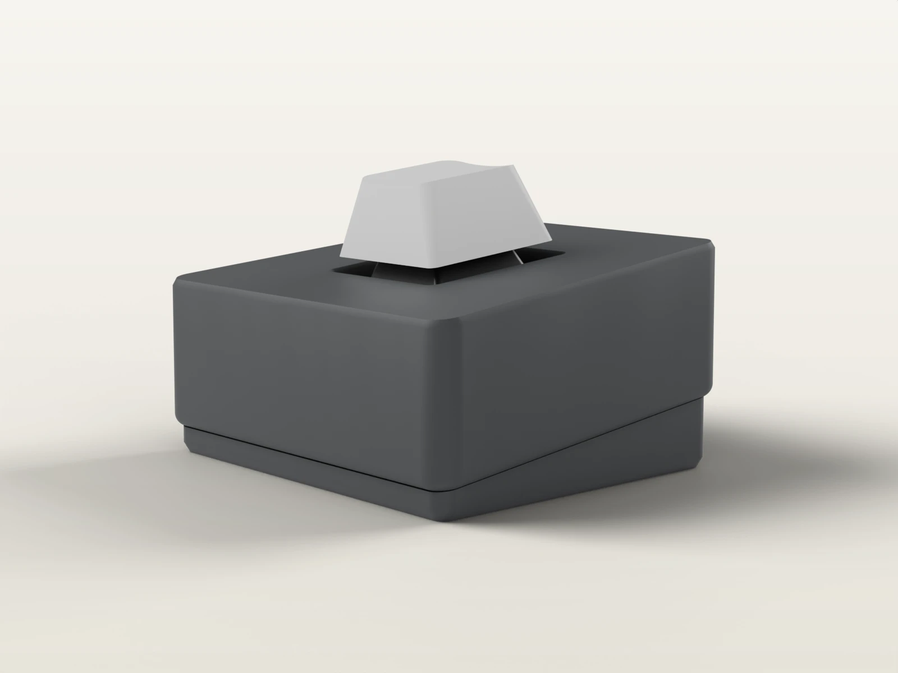
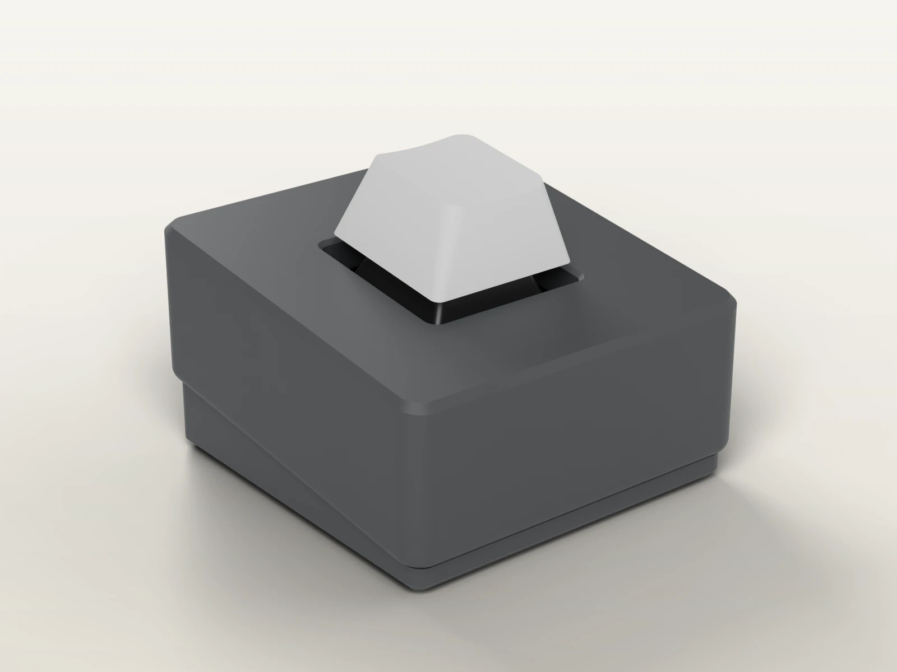
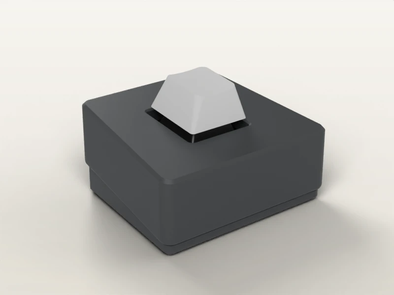

# DAIS

> ### Desktop Assignable Input Switch

A one-key MX macropad. A dais is a raised
platform for something on display -- here, a single key, standard or artisan. A Khor
microSAM controller (RP2040, Pro Micro footprint, USB-C), upstream QMK firmware, and a
parametric 3D-printed case generated in Python with [build123d](https://build123d.readthedocs.io).



A miniature keyboard rather than a box: a wedge at a 7 deg typing angle, the key sunk in a 1U
well inside wide bezels, crisp chamfered edges, single-wall sculpted sides and no engravings.

## Designs

| [Side coves](docs/designs/side-cove.md) | [Wrap cove](docs/designs/wrap-cove.md) |
|---|---|
|  |  |
| one-piece wedge, a teardrop ball-cutter cove on each side | one continuous cove along the front, round the corners and down each side |
| [**Split case**](docs/designs/split.md) | [**Split case, trapezoidal plan**](docs/designs/split-trapezoid.md) |
|  |  |
| top case over an inset bottom case; the seam is the feature | the split case, front 53.6 mm, back 43.6 mm |

All four: 44.8 mm deep, 19.7 mm high at the front and 25.2 mm at the back (+0.8 mm feet);
ASA-CF shells with the **switch plate built in**, **M3 heat-set inserts**, TPU feet, every shell
printable without supports (60 deg bevels on the bed). The split designs take optional **skin
patterns** -- fuzzy skin (via a slicer modifier), voronoi leather cells, facets -- and `--legacy`
rebuilds the first prototypes
(separate plate, M2 self-tapping). See [Options and patterns](docs/designs/options.md).

## Quick start

```bash
make dev       # .venv + editable install (build123d, pytest, ruff)
make build     # build, check and export every design -> out/microsam/
make test      # geometric acceptance tests
```

```text
out/microsam/
├── side-cove/        {stl,step}/  body  bottom  feet
├── wrap-cove/        {stl,step}/  body  bottom  feet
├── split/            {stl,step}/  top-case  bottom-case  feet
├── split-trapezoid/  {stl,step}/  top-case  bottom-case  feet
└── coupon/           {stl,step}/  coupon
```

`dais build --pattern voronoi` adds `split-voronoi/` and `split-trapezoid-voronoi/` (any of
`fuzzy`, `voronoi`, `facets`, or `all`). Each design directory is a complete print set. Print `coupon/` first and set `SW_CUT` from it.
Parts are exported in assembly position: shells print **top face on the bed** (see
[Printing](docs/guide/printing.md)).

The firmware is the upstream QMK `handwired/onekey` target with the keymap in
`firmware/keymaps/enter/` ([Firmware](docs/guide/firmware.md)):

```bash
cp -r firmware/keymaps/enter ~/qmk_firmware/keyboards/handwired/onekey/keymaps/
qmk compile -kb handwired/onekey/promicro -km enter -e CONVERT_TO=rp2040_ce
```

## Documentation

The full documentation is published at **https://szaghi.github.io/dais/** (VitePress sources in
`docs/`; `make docs-dev` to browse them locally):

- [About](docs/guide/index.md) -- design language, hardware, repository layout
- [Designs](docs/designs/index.md) -- the four variants, with every view
- [Printing](docs/guide/printing.md), [Assembly](docs/guide/assembly.md) (BOM, wiring),
  [Firmware](docs/guide/firmware.md)
- [Parameters](docs/guide/parameters.md), [Architecture](docs/guide/architecture.md),
  [Development](docs/guide/development.md)
- [Status](docs/guide/status.md) -- open measurements before the final print

## Status

Prototype stage. Still to measure: the switch cutout (coupon), the USB-C cable overmold, the
tallest component under the switch, and the microSAM pinout (short A3-A2 before soldering).

## License

[MIT](LICENSE) -- code, generated CAD files, renders, documentation and the QMK keymap alike.
