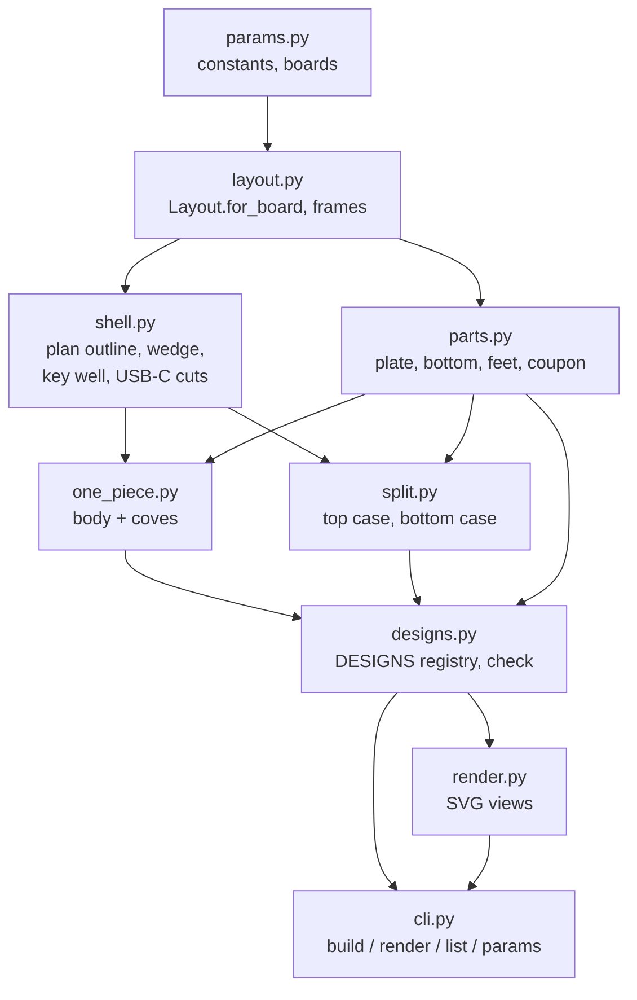

# Architecture

The case is plain Python on [build123d](https://build123d.readthedocs.io) (OpenCascade
underneath), in the `dais` package under `src/`.

## Everything derives from the board

`Layout.for_board(board, front_extra)` computes every dimension. The width comes from the well
plus the bezels; the depth from the board length plus the front stop and the USB-C setback; and
the **key height** is built bottom-up: floor, board pocket, PCB, the tallest component
(`COMP_H`), the wire gap (`WIRE_GAP`), and the lowest point of the tilted switch (housing corner
or pin tip). The top surface follows from `WELL_DEPTH`. Changing a board or switch constant
moves the whole case; `for_board` raises when the board no longer fits between the bosses or the
plate no longer fits the cavity. `front_extra > 0` turns the rectangular plan into an
isosceles trapezoid.

## Reference frames

| Frame | Origin and axes | Built in it |
|---|---|---|
| world | z = 0 at the case bottom; -Y front (low side), +Y back (USB-C) | outlines, bosses, board seat |
| key (`lay.key`) | plate-top centre, rotated `TILT` about X | key well, plate, plate screws, side coves |
| parting (`parting()`) | `SPLIT_FRONT_Z` up the front face, parallel to the top | seam, rebate, lip, screw slabs |

`below_roof`, `above_floor`, `half_space` and `between` turn these frames into half-spaces and
slabs. Cutters are built oversized (`lay.big`) and clipped by intersection rather than sized
exactly.

## Plan outline

`plan_pts(lay, inset)`, `side_x` and `outline(lay, offset)` describe the plan shrunk by an
inset measured **normal to each edge**, so on the trapezoid the rim, rebate, lip, cavity and
screw axes all follow the angled sides. Anything that must hug a wall uses them, never an
axis-aligned box.

## Designs and checks

`designs.DESIGNS` maps each design name to a `Design`: its title, its plan (`front_extra`) and
a function returning its parts in assembly position. `Design.build(board)` runs `check()` on the
result: every part a valid solid, a single connected solid (the two feet excepted), and no two
parts intersecting by more than 1e-3 mm^3. The CLI builds each design in its own process.

## OpenCascade pitfalls met here

- **Coincident faces** in a union give an invalid solid: trim by 0.01 mm (the bottom-case
  screw columns stop 0.01 inside the lip faces).
- **Booleans can fail silently**: a cylinder cut into an already-filleted plate corner was
  dropped at one corner of four, with the result still a valid solid. The plate reliefs are
  cut before the corner fillets, and a test checks all four corners.
- **Edge breaks select faces by position** (`faces().sort_by(Axis.Z)[0]`, the seam face sorted
  along the tilted normal), so a boolean that adds a lower or higher face changes what gets
  chamfered.
- `check()` catches overlaps, not insufficient clearance: clearances are tested separately.
